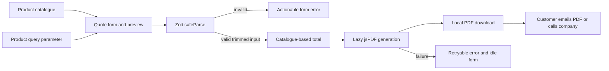

# Architecture and behavior contracts

Supreme Energy is a Next.js 16 Pages Router marketing site with a local PDF
estimate builder. It has no application API, database, account system, request
queue or email-delivery service. A successful PDF download does not submit an
order or contact the company.

## Runtime and module boundaries

| Area                           | Responsibility                                                                                            |
| ------------------------------ | --------------------------------------------------------------------------------------------------------- |
| `src/pages`                    | Public routes and Next's framework entry points. Pages use `next/head` for metadata.                      |
| `src/components/site`          | Company layout, navigation, product presentation and quote form state.                                    |
| `src/data/products.ts`         | Authoritative product identifiers, units, indicative rates and price-list timestamp.                      |
| `src/lib/quote.ts`             | Quote input schema, inferred domain types and total calculation.                                          |
| `src/lib/pdf/buildQuoteDoc.ts` | Lazy-loaded jsPDF rendering, pagination and browser download lifecycle.                                   |
| `src/lib/site.ts`, `images.ts` | Public company/service information and local asset paths.                                                 |
| `src/components/ui`            | Reusable Radix/shadcn controls. Their presence does not mean every control is used by the marketing site. |
| `tests/pages`                  | Route-level component tests. Tests stay outside `src/pages` so Next cannot publish them as routes.        |

The normal build prerenders the public pages and creates a standalone Node
server. `scripts/prepare-standalone.mjs` copies the public and compiled static
assets beside that server, so `npm start` serves the same output tested by CI.
The container packages this runtime; it has no companion services to compose.
Google Fonts are a browser dependency, not a prerequisite for compilation.

## Quote data flow

The query parameter selects a known catalogue product; absent or unknown IDs
fall back to diesel. It does not supply prices. The schema validates required
contact/destination fields, field lengths, email format, phone syntax, known
product IDs and finite positive quantities. A quote accepts 1–50 lines and at
most 10,000,000 units per line. Fractional quantities are supported.

The calculator reads rates from the catalogue and rejects invalid lines rather
than silently pricing them at zero. LPG quantities are in kilograms; the other
products use litres. Totals include `DELIVERY_ALLOWANCE`, currently zero. Money
is displayed as whole NGN for an indicative estimate; this is not an invoicing
or accounting system. Final supply and delivery charges require confirmation.

PDF generation uses the validated snapshot, wraps customer details and delivery
notes, paginates long line-item lists, and revokes its temporary blob URL after
download. A generation failure resets the form so the customer can retry.
Customer details remain in browser memory and the downloaded document; the
form does not persist or transmit them.

## Interaction contracts

- Navigation identifies the current page, exposes its mobile expanded state,
  closes after a destination is selected, and restores toggle focus on Escape.
- The homepage slideshow supports explicit pause/resume and manual selection.
  Automatic rotation stops during hover, keyboard focus, or reduced-motion
  preference. Hidden slide links are excluded from the keyboard tab order.
- The shared carousel uses horizontal or vertical arrow keys as appropriate,
  leaves editable fields' keys alone, and removes both engine subscriptions.
- Menu styling is shared through `_shared/menu-primitives.ts`. Each menu keeps
  its original typed Radix wrapper, ref and keyboard/selection behavior;
  generic wrapper factories would obscure those different component APIs.
- Sidebar state, layout, menu controls and public exports are separate modules.

## Validation and known limits

Run `npm ci`, `npm run check`, and `npm run build` with Node 24 and npm 11.
GitHub Actions also audits the lockfile, starts the built server, requests every
public route, and builds/smoke-tests the container. JUnit and coverage reports
are retained as the `quality-reports` artifact on each quality-job run.

The component tests render real Next/Radix components with an isolated router
context. Carousel unit tests substitute the layout engine so its callbacks and
subscriptions can be exercised deterministically. The suite is not a real
browser end-to-end or visual-regression suite. `_app` and `_document` are
framework wrappers verified by the production build rather than DOM unit tests.
Coverage does not claim to cover every unused UI primitive.

No credentials or environment file are required. All `.env*` files are excluded
from Git. Any future delivery API needs its own server-side validation, abuse
controls, request limits, secret handling and success/failure integration tests;
client-side validation alone would not protect that new trust boundary.
